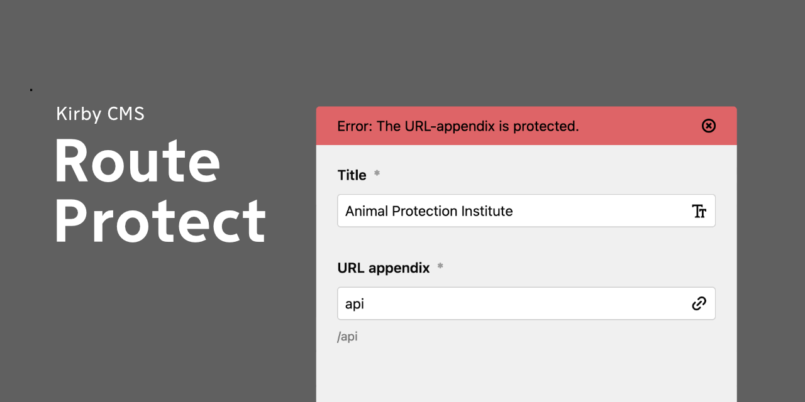

# Plugin Kirby Route Protect

Un complemento para [Kirby](https://getkirby.com) que evita que los usuarios del panel creen URL de páginas que entren en conflicto con rutas y carpetas existentes.

**Versiones probadas:** 3.9.0, 4.0.1, 5.0.4

## Instalación

### Descarga

Descarga y copia este repositorio en `/site/plugins/kirby-route-protect`.

### Submódulo de Git

	git submodule add https://github.com/andreasnymark/kirby-route-protect.git site/plugins/kirby-route-protect

## Uso

El complemento detecta automáticamente todas las rutas del proyecto, tanto las personalizadas como las de Kirby. Puedes agregar las tuyas en **site/config/config.php**

	return [
		'andreasnymark.kirby-route-protect' => [
				'slugs' => [ 'protected-slug', 'another-protected-slug' ],
			],
		]
	];
	
A partir de la `v1.2.0`, el complemento también verifica la existencia de carpetas.

## Descargo de responsabilidad

Este complemento se proporciona "tal cual" sin ninguna garantía. Úsalo bajo tu propio riesgo y pruébalo siempre por tu cuenta antes de utilizarlo en un entorno de producción. Si encuentras algún problema, por favor crea [un nuevo issue](//github.com/andreasnymark/kirby-route-protect/issues/new).

## Licencia

[MIT](https://opensource.org/licenses/MIT)

Queda prohibido utilizar este complemento en cualquier proyecto que promueva el racismo, el sexismo, la homofobia, la crueldad animal, la violencia o cualquier otra forma de discurso de odio.
